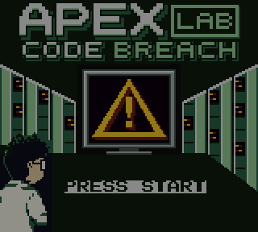
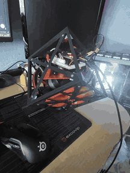
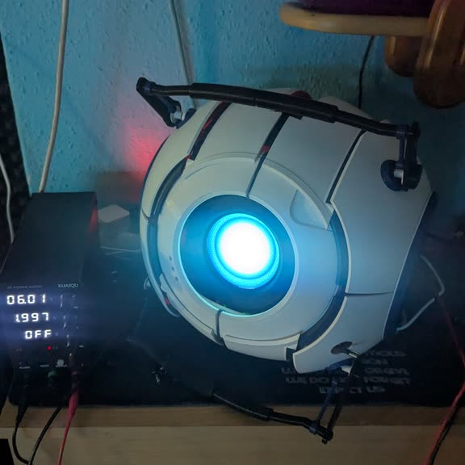
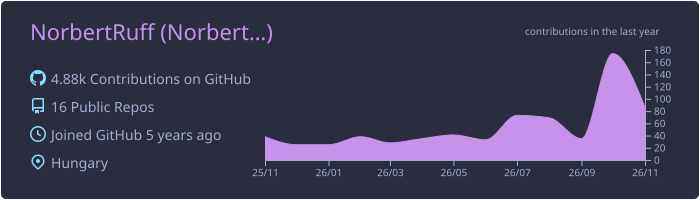
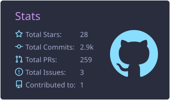
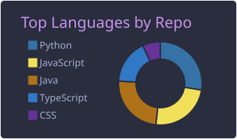
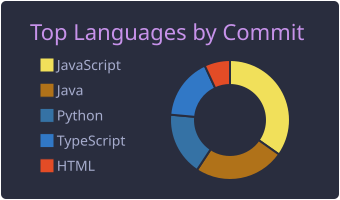
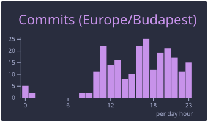

<div align="center">



<br/>

[](https://www.linkedin.com/in/ruff-norbert/) [](mailto:ruffnorbert88@gmail.com)  

</div>

## 👨🏻‍💻 About Me

```markdown
- 💼 Full-Stack Developer & Cloud Architect at Apex Lab since 2021
- ☁️ AWS Certified Developer – Associate & Cloud Practitioner
- 🔌 Off the clock I build on real hardware: ESP32s, servos, SDRs, Game Boys
- 🥅 2026 goals: ship the pet projects, not just start them
- ⚡ Fun fact: I still love old technology 🙌
```

## 🔧 On the workbench

| Project | What it is | Stack |
|:--|:--|:--|
| 🤖 **Wheatley** | 3D-printed animatronic Wheatley: speech-to-text, LLM, TTS and 11 servos | Python · Radxa Zero 3W |
| 🧊 **Cubli** | Self-balancing cube on three reaction wheels, PID tuning over Bluetooth | ESP32 · C++ · Kotlin |
| 💧 **HangaPalack** | DIY smart water bottle: load cell, LEDs and a BLE companion app | ESP32-C3 · React Native |
| 🎮 **Code Breach** | A 5-level Game Boy / Game Boy Color platformer, v1.0 released | C · GBDK-2020 |
| 📡 **Spectrum Analyzer** | Turns an ADALM Pluto SDR into a real-time RF sweep visualiser | Python · PyQt6 |
| ⌚ **Pixel Watch Face** | Custom Wear OS face for the Pixel Watch 4 | Watch Face Format · Kotlin |
| 📊 **[NeoGauge](https://github.com/NorbertRuff/NeoGauge)** | Hardware monitor skin for Rainmeter | Rainmeter · Lua |

### 🎬 Straight from the workbench

<table align="center">
  <tr>
    <td align="center"></td>
    <td align="center"></td>
    <td align="center"></td>
  </tr>
  <tr>
    <td align="center"><b>Code Breach</b><br/><sub>Game Boy platformer in C</sub></td>
    <td align="center"><b>Cubli</b><br/><sub>ESP32 reaction-wheel cube</sub></td>
    <td align="center"><b>Wheatley</b><br/><sub>work in progress: servos next</sub></td>
  </tr>
</table>

## 🛠️ Tech Stack

<div align="center">


<sub>…and whatever the project needs next.</sub>

</div>

##  GitHub Stats

<div align="center">



[](https://github.com/vn7n24fzkq/github-profile-summary-cards)

[](https://github.com/vn7n24fzkq/github-profile-summary-cards)
[](https://github.com/DenverCoder1/github-readme-streak-stats)

[](https://github.com/vn7n24fzkq/github-profile-summary-cards)
[](https://github.com/vn7n24fzkq/github-profile-summary-cards)
[](https://github.com/vn7n24fzkq/github-profile-summary-cards)


<br/><br/>


</div>

